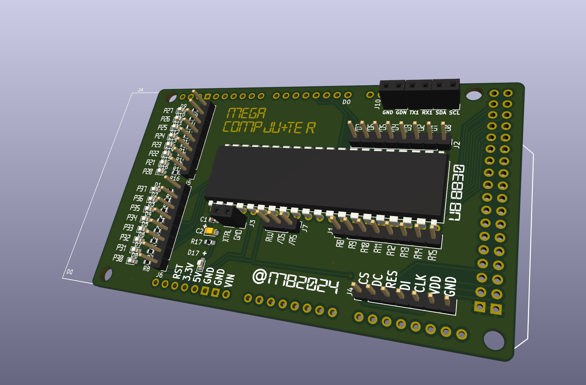
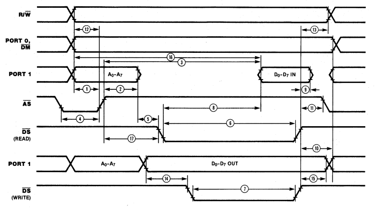

# MEGA CompJU+TEr



# Status

Just an Idee. Made a basic PCB. Started experimenting...

# Wath's this ?

Arduino MEGA Shield with a UB8830 on top. The UB8833 is a Ostblock version of a Zilog Z8682 with a view quirks.

A bit like these things... http://8bitforce.com/projects/retroshield/ [Or here the Z80 code](https://gitlab.com/8bitforce/retroshield-arduino/-/blob/master/kz80/kz80_test/kz80_test.ino?ref_type=heads)

### Bugs / Improvements

* UB8833 reset(pin6) to some pin(45) ! keep it low until all ports initialize.
* LEDs for AS,RW,DS ?
* Fuse ? The Z8 needs 180mA !?
* break out some more arduino pins for debugging.

# Software

From Z8 datasheet...



* When AS goes LOW->HI latch the low adr byte. And read and keep RW flag.
* When DS goes HIGH->LOW and RW is reading (HIGH) put data on the bus. 
* When DS goes low and writing, read the data, do something e.g. save to ram.
* Turn of Data output ??? When ??? Read data to DS 1 hold time is 0, so turn it off after DS goes high.

### Reset

8833 RESET-Eingang (vgl . Kapitel 1). Hat er nach eingeschwungener
Spannungs- und Taktversorgung für mindestens **18** Taktperioden
Nullpegel, erzeugt er im Inneren des Einchip-Mikrorechners einige
festgelegte Zustände . 

in kurzes Programm ab %000C im Test-ROM konfiguriert Port 0, Port 1 und
P34 für den Anschluß des externen Speichers und springt auf Adresse %0812

Der UB 8830 D (UB 8831 D) besitzt auch bei „normalem” Rücksetzen die ge-
nannten Interruptvektoren und springt auf die Adresse %0812,
wenn dort kein RAM bestückt ist und P32 keine Verbindung zu P35 hat.

Der Einchip-Mikrorechner besitzt ein Testprogramm im internen ROM,
das sich für unsere Zwecke gut ausnutzen läßt. Damit es vom
Prozessor ausgeführt wird, muß eine Drahtbrücke die Port
Anschlüsse P32 und P35 verbinden. .......  0-Impulse
mit einer Breite von 11 μs erscheinen. Jede Abweichung
von dieser Regel deutet auf eine Fehlverbindung zwischen
benachbarten Leiterzügen. Bei Inbetriebnahme mit Kopfhörer
o. ä. müssen diese 16 Anschlüsse mit gleichlauten 5,45-
kHz-Tönen 

Der laeuft mit 8mhz, auf dem Arduino mit 70khz, Faktor 114, 1254us.

### First something ?

after applying reset for at least 3 clocks it started doing things
* AS, DS, RW go up and down
* But no data on the bus !? -> could the thing be running it's internal ROM first ? Then there should be a addr=0x0800 (ext reset vector) comming up some time.. When it reads 0 it would start @0 again ???
* Oszi say it starts reading and writing to 0x0812 after about 173 initial clocks. it writes 0xff ?
  * AS can go down without DS doing things, especially after reset 27 times. Propably working on internal ROM/RAM whatever.
  * When connecting P32 to P35, it activates all bits at the data and address lines so connections can be traced.

### Second thing

in the 31st cpu cycle it seems to read the reset vector but only the first byte 0x8d which is a JP it schould also read the next 2 bytes to get the target addr but instead it idles ~ for 2 clockcycles ??? and then decides to go to 0xffff ??? So where the addr should be read it seems to interpred a ffff but there is no adr strobe !?

```
31 R addr:0812-1 ~_[8d]2_[8d]3_[8d]4_[8d]5~~~~~~~~~~~~~
34 R addr:ffff-1 ~_[ff]2_[ff]3_[ff]4_[ff]5_[ff]6~~
35 R addr:ff00-1 ~~~~~~~~~~
36 R addr:fffd-1 ~_[ff]2_[ff]3_[ff]4_[ff]5_[ff]6~~
37 R addr:fffc-1 ~~~~~~~~~~
38 R addr:fffb-1 ~_[ff]2_[ff]3_[ff]4_[ff]5_[ff]6~~
39 R addr:ffba-1 
as#:40
```

# PCB

| ATMega Pin Port | UB8833 | Comments |
|---|---|---|
| PA | AdrHi | hi adr byte |
| PC | AdrLow/Data bus | multiplexed Data/Adr bus |
| | | |
| D2(int0) | AS | Adr strobe, Lo->Hi store the low adr |
| D3(int1) | DS | Data strobe, ?? |
| | | |
| D46/PL3(pwm pin) | XTAL | Clock |
| D47/PL2 | RW | Read/Write indication |

| ATMega Pin | Display |
|---|---|
| D53 | CS |
| D49 | DC |
| D51(mosi) | DI |
| D52(sclk) | CLK |

# Refs

https://github.com/boert/JU-TE-Computer

https://hc-ddr.hucki.net/wiki/doku.php/tiny/dokumentation 

https://www.robotrontechnik.de/html/forum/thwb/showtopic.php?threadid=16374

https://hackaday.com/2020/07/17/a-z80-board-with-very-few-parts/

http://bitsavers.informatik.uni-stuttgart.de/components/zilog/z8/Z8681_Data_Sheet_Mar83.pdf
